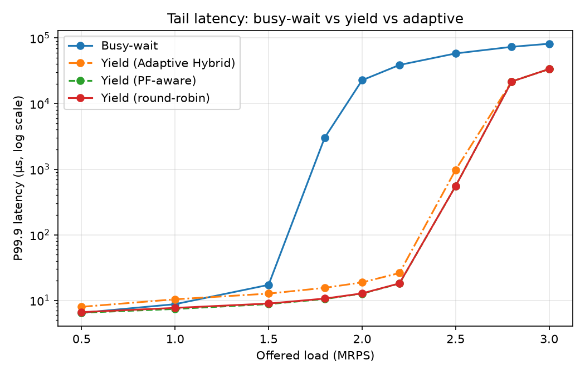
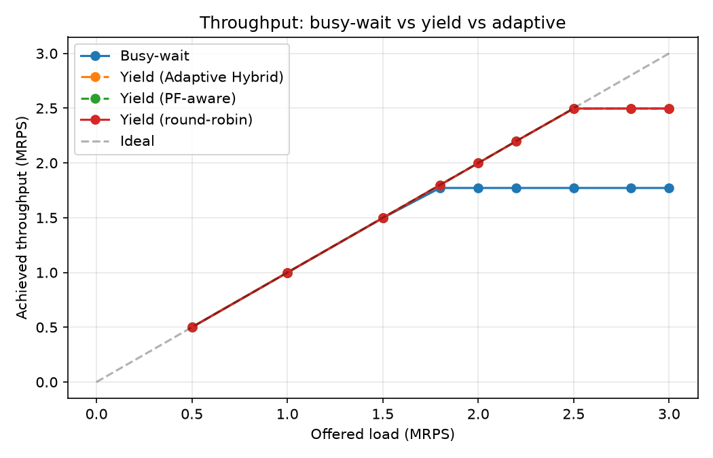
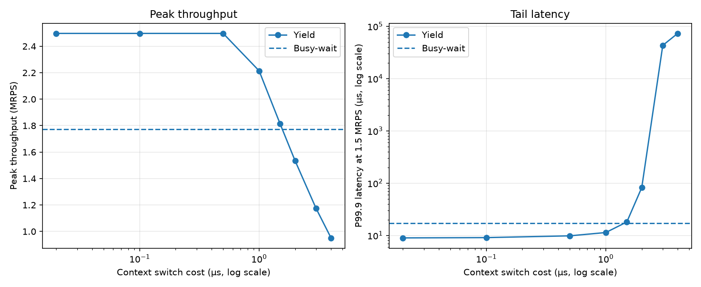
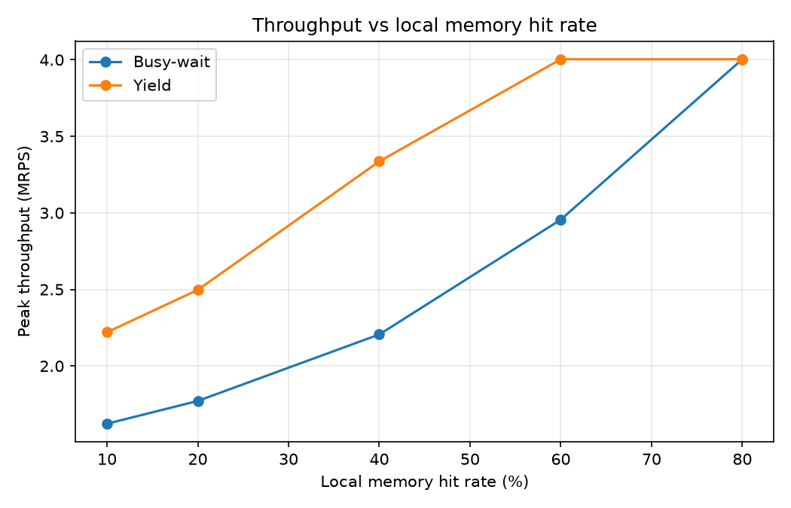
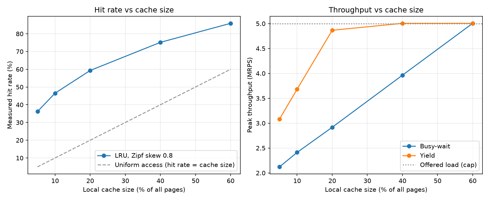
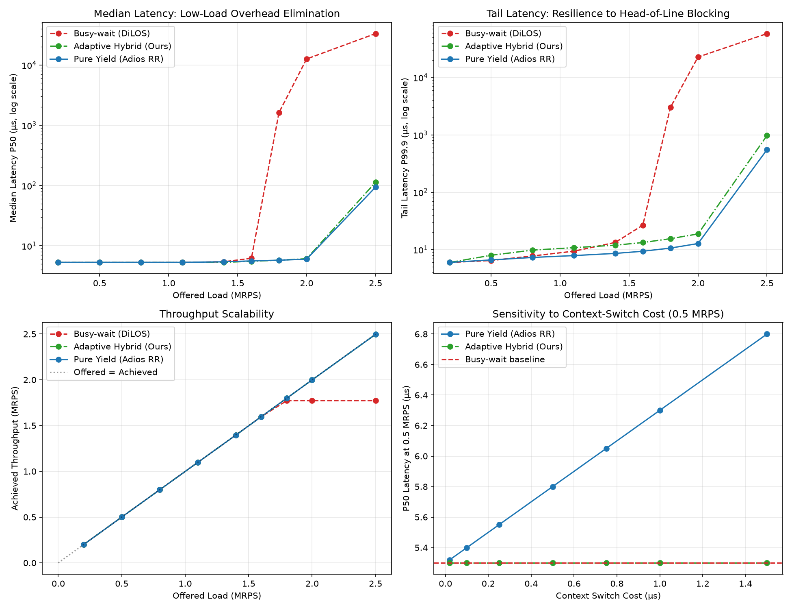

# Adios Simulation: Busy-wait vs Yield-based Page Fault Handling

A discrete-event simulation (Python + [SimPy](https://simpy.readthedocs.io/)) of the core mechanism behind **Adios**, a system for memory disaggregation. When a request hits a page fault on remote memory, should the worker **busy-wait** for the RDMA fetch, or **yield** and serve other requests while the page is in flight?

The simulation compares the two designs on throughput and tail latency, and tests how the result changes with load, context-switch cost, local hit rate, cache size and access skew.

> **Scope.** This is a simulation of the paper's core idea, **not an implementation of Adios**. The user-level threads (unithreads), the unikernel, real RDMA hardware, polling delegation and the reclaimer thread are not built. The simulator uses fixed service times, so results should be read as trends, not as predictions of real hardware.

## Contents

1. [Background](#1-background)
2. [The paper](#2-the-paper)
3. [What is modelled](#3-what-is-modelled)
4. [Repository layout](#4-repository-layout)
5. [Getting started](#5-getting-started)
6. [Results](#6-results)
7. [Validity and limitations](#7-validity-and-limitations)
8. [Customising and extending](#8-customising-and-extending)

---

## 1. Background

In a disaggregated-memory setup, a compute node keeps a small amount of memory locally and fetches the rest, one 4 KB page at a time, from a memory node over RDMA. A local miss is a **page fault**, and the fetch takes a few microseconds. There are two ways to handle the wait:

- **Busy-wait.** The worker blocks until the page arrives. Nothing else runs on that worker, so requests queue behind it (head-of-line blocking).
- **Yield.** The worker issues the fetch, switches to another ready request, and resumes the faulting one when the page arrives. This recovers the lost CPU time but costs a context switch on each side of the wait.

Timeline of one remote (miss) request, using this project's default times (µs):

```
Busy-wait  worker  [ CPU 1.15 ][ blocked on RDMA, 3.0 ][ CPU 1.15 ]          worker busy 5.30
Yield      worker  [ CPU 1.15 ][sw][ serves other requests ][sw][ CPU 1.15 ] worker busy 2.34
           RDMA                    [ fetch in flight, 3.0 ]
```

A local hit costs 0.85 µs of CPU in both systems.

## 2. The paper

- **Paper Title:** *Adios to Busy-Waiting for Microsecond-scale Memory Disaggregation*
- **Authors:** Wonsup Yoon, Jisu Ok, Sue Moon, and Youngjin Kwon (KAIST)
- **Conference:** Twentieth European Conference on Computer Systems (**EuroSys '25**), March 30–April 3, 2025, Rotterdam, Netherlands.
- **Local PDF Copy:** [adios-eurosys25.pdf](adios-eurosys25.pdf)
- **Official DOI:** [10.1145/3689031.3717475](https://doi.org/10.1145/3689031.3717475)
- **Official Source Code:** [ANLAB-KAIST/adios](https://github.com/ANLAB-KAIST/adios)
- **Community Summary:** [EuroSys 2025 paper summaries](https://eunomia.dev/blog/2025/04/25/eurosys-2025-paper-summaries-and-analysis/)

Adios reintroduces yielding on page faults using ultra-lightweight user-level threads ("unithreads") in a single-address-space unikernel, accompanied by a Page-Fault-Aware dispatch algorithm that balances RDMA queue usage across worker cores. On real workloads it reports **1.07x to 1.64x** higher throughput than the busy-waiting baseline DiLOS and **1.99x to 10.9x** lower P99.9 tail latency.

## 3. What is modelled

### Systems

| System | File | Behaviour |
|---|---|---|
| Busy-wait | `busywait.py` | 8 workers pull from one central FIFO queue. On a fault the worker blocks until the RDMA fetch completes. |
| Yield, round-robin (`rr`) | `yieldsys.py` | A dispatcher hands requests to **idle** workers in round-robin order. On a fault the worker issues the fetch, pays one context switch, and takes other work. When the page arrives the worker pays another switch and finishes the request. Resumed requests take priority over new ones. |
| Yield, page-fault-aware (`pf`) | `yieldsys.py` | Same as above, but the dispatcher picks the idle worker with the **fewest outstanding fetches** (ties broken round-robin). This balances RDMA queue pair usage. |
| Yield, adaptive hybrid (`adaptive`) | `yieldsys.py` | **Our Extension:** Dynamically balances busy-waiting and yielding. When uncontended with idle worker capacity, workers spin-wait directly to eliminate context-switch penalties ($P_{50}$); when queues build or workers are scarce, workers yield immediately to prevent Head-of-Line blocking ($P_{99.9}$). |

`MAX_INFLIGHT` bounds the number of requests in the yield system at once. It stands in for the fixed pool of unithreads in the real system.

### RDMA model (`rdma.py`)

Both systems use the same model, so the comparison is fair. A fetch passes through three stages:

1. the issuing worker's **queue pair** (one per worker, capacity 1, 1.0 µs of service),
2. one **shared link** (capacity 1, 0.5 µs per page),
3. a fixed **network latency** (1.5 µs).

An unloaded fetch takes 3.0 µs. Under load, fetches queue at the queue pair and at the shared link.

### Page cache (`cache.py`, optional)

With `USE_CACHE = True`, a fault is decided by a real LRU cache instead of a fixed probability. Page popularity follows a Zipf distribution (`ZIPF_S = 0` is uniform), so the hit rate comes from the cache size and access skew. The cache starts warm, pre-filled with the most popular pages.

### Workload and measurement

- **Arrivals:** open-loop Poisson at the offered load. 1 MRPS equals one request per µs.
- **Requests:** a hit with probability `LOCAL_HIT_PROB` (20%), otherwise a miss. Remote CPU time is split evenly before and after the fetch (`FAULT_SPLIT = 0.5`).
- **Latency:** arrival to completion, including queueing. Only requests that arrive after the warm-up are included in the percentiles.
- **Throughput:** requests *completed* after the warm-up, divided by the post-warm-up window.
- **Peak throughput:** throughput at an offered load high enough to saturate the system.
- **Units:** all times are in µs; load is in MRPS.

### Default parameters (`config.py`)

| Parameter | Value | Meaning |
|---|---|---|
| `NUM_WORKERS` | 8 | Worker cores |
| `LOCAL_HIT_PROB` | 0.20 | Fraction of requests served from local memory |
| `LOCAL_TIME` | 0.85 µs | CPU time of a local hit |
| `REMOTE_CPU_TIME` | 2.3 µs | CPU time of a miss (excluding the fetch) |
| `RDMA_FETCH_TIME` | 3.0 µs | Unloaded fetch time (`QP_SERVICE` 1.0 + `LINK_TIME` 0.5 + `NET_LATENCY` 1.5) |
| `CONTEXT_SWITCH` | 0.02 µs | Cost of one switch (yield system) |
| `MAX_INFLIGHT` | 4096 | In-flight request pool (yield system) |
| `SIM_DURATION` / `WARMUP` | 200,000 / 20,000 µs | Simulated time and discarded warm-up |
| `SEED` | 42 | Random seed |
| `NUM_PAGES`, `CACHE_FRACTION`, `ZIPF_S` | 100,000, 0.20, 0.0 | Cache model (only if `USE_CACHE = True`) |

## 4. Repository layout

| File | Purpose |
|---|---|
| `config.py` | All parameters |
| `rdma.py` | RDMA queue-pair and shared-link model |
| `cache.py` | LRU page cache and Zipf page generator |
| `busywait.py` | Busy-wait baseline (also a quick sanity check when run directly) |
| `yieldsys.py` | Yield-based system: round-robin, PF-aware, and Adaptive Hybrid dispatch |
| `run_experiments.py` | Busy-wait vs yield vs adaptive across offered loads |
| `plots.py` | Tail-latency and throughput graphs from `compare.csv` |
| `pf_vs_rr.py` | PF-aware vs round-robin, averaged over 5 seeds |
| `sweep_hitrate.py` | Peak throughput vs local hit rate |
| `sweep_switchcost.py` | Context-switch cost sweep |
| `sweep_cache.py` | LRU + Zipf skew and cache-size sweeps |
| `sweep_adaptive.py` | **Our Extension:** Evaluation suite for Load-Aware Adaptive Hybrid Yielding |
| `results/` | CSV data and PNG graphs produced by the scripts |

## 5. Getting started

```bash
python3 -m venv venv
source venv/bin/activate          # Windows: venv\Scripts\activate
pip install simpy numpy pandas matplotlib
```

Tested with Python 3.12 / 3.13, simpy 4.1.2, numpy, pandas and matplotlib.

Run the scripts from the project folder, in this order (`plots.py` needs the CSV from `run_experiments.py`):

```bash
python busywait.py          # quick sanity check, writes results/busywait.csv
python run_experiments.py   # writes results/compare.csv
python plots.py             # writes results/p999_vs_load.png, results/throughput_vs_load.png
python pf_vs_rr.py          # writes results/pf_vs_rr.csv
python sweep_hitrate.py     # writes results/hitrate_sweep.csv and .png
python sweep_switchcost.py  # writes results/switchcost_sweep.csv and .png
python sweep_cache.py       # writes results/cache_sweep.csv and .png
python sweep_adaptive.py    # our extension: writes results/adaptive_eval.png and CSVs
```

Each simulation run takes roughly 5 to 15 seconds, so the scripts differ mainly in how many runs they make: `run_experiments.py` makes 36, `sweep_hitrate.py` 10, `sweep_switchcost.py` 18, `sweep_cache.py` 20, `sweep_adaptive.py` 42, and `pf_vs_rr.py` 100.

## 6. Results

Throughput values marked **†** equal the offered load, which means the system kept up. Read them as "at least this much", not as capacity.

### 6.1 Headline numbers

| Result | Value |
|---|---|
| Peak throughput, busy-wait | 1.77 MRPS |
| Peak throughput, yield | 2.50 MRPS, about **1.4x** busy-wait |
| P99.9 latency at 1.5 MRPS | yield 8.9 µs vs busy-wait 17.2 µs, about **1.9x lower** |
| P99.9 latency at 1.8 MRPS | yield 10.6 µs vs busy-wait 3,014 µs (busy-wait is past saturation) |
| PF-aware vs round-robin | at most about 1.2% better P99.9, fading near saturation |
| Context-switch cost | yield beats busy-wait only while a switch costs under about 1.5 µs |
| LRU cache check | uniform access with a 20% cache gives a 19.9% hit rate, matching the fixed 20% model |

### 6.2 Throughput and tail latency vs offered load

Source: `results/compare.csv`. Latencies are P99.9 in µs.

| Offered (MRPS) | Busy-wait throughput | Busy-wait P99.9 | Yield (RR) throughput | Yield (RR) P99.9 | Adaptive throughput | Adaptive P99.9 |
|---:|---:|---:|---:|---:|---:|---:|
| 0.5 | 0.50 | 6.5 | 0.50 | 6.6 | 0.50 | 8.0 |
| 1.0 | 1.00 | 8.7 | 1.00 | 7.7 | 1.00 | 10.4 |
| 1.5 | 1.50 | 17.2 | 1.50 | 8.9 | 1.50 | 12.7 |
| 1.8 | 1.77 | 3,014 | 1.80 | 10.6 | 1.80 | 15.5 |
| 2.0 | 1.77 | 22,685 | 2.00 | 12.8 | 2.00 | 18.8 |
| 2.2 | 1.77 | 38,788 | 2.20 | 18.1 | 2.20 | 26.1 |
| 2.5 | 1.77 | 58,113 | 2.50 | 552 | 2.50 | 973 |
| 2.8 | 1.77 | 73,297 | 2.50 | 21,709 | 2.50 | 21,709 |
| 3.0 | 1.77 | 81,733 | 2.50 | 33,580 | 2.50 | 33,580 |





Below saturation the two systems are close, though yield already pulls ahead on the tail at 1.5 MRPS. Once the offered load passes a system's capacity, its queue grows without bound, so latencies in the saturated rows (tens of thousands of µs) mostly reflect queue build-up over the simulated window and depend on `SIM_DURATION`. Use them to see *where* each system saturates, not as absolute values.

### 6.3 Why yield wins here

The ceilings follow directly from the parameters:

- **Busy-wait is CPU-bound.** A worker is occupied for the whole fetch, so the mean service time is 0.2 x 0.85 + 0.8 x (2.3 + 3.0) = 4.41 µs. Eight workers give 8 / 4.41 = **1.81 MRPS** (simulated: 1.77, the small gap comes from RDMA queueing).
- **Yield moves the bottleneck to the network.** The CPU cost per request falls to 2.04 µs, a CPU ceiling of about 3.9 MRPS. The shared link then becomes the limit: it serves 2 pages per µs, and 80% of requests need a page, so the ceiling is 2 / 0.8 = **2.5 MRPS** (simulated: 2.50).

So the yield gain in this configuration is capped by the shared link, not by the CPU. A faster link would let yield pull further ahead.

### 6.4 PF-aware vs round-robin dispatching

Source: `results/pf_vs_rr.csv`. Mean P99.9 over 5 seeds (1 to 5). Gain = (RR - PF) / RR.

| Offered (MRPS) | Gain, QP service 1.0 µs | Gain, QP service 2.0 µs |
|---:|---:|---:|
| 1.8 | +1.22% | +1.17% |
| 2.0 | +0.81% | +0.78% |
| 2.2 | +0.57% | +0.32% |
| 2.3 | +0.37% | +0.42% |
| 2.4 | +0.09% | -0.12% |

PF-aware dispatching helps slightly at moderate load and the gain fades toward saturation. At the highest load with the slower queue pair it is marginally worse. The effect is small and was not tested for statistical significance.

### 6.5 Context-switch cost

Source: `results/switchcost_sweep.csv`. Busy-wait reference: peak 1.77 MRPS, P99.9 17.2 µs at 1.5 MRPS.

| Switch cost (µs) | Yield peak (MRPS) | Yield P99.9 at 1.5 MRPS (µs) |
|---:|---:|---:|
| 0.02 | 2.50 | 8.9 |
| 0.1 | 2.50 | 9.1 |
| 0.5 | 2.50 | 9.8 |
| 1.0 | 2.21 | 11.3 |
| 1.5 | 1.81 | 18.0 |
| 2.0 | 1.53 | 82.0 |
| 3.0 | 1.17 | 43,133 |
| 4.0 | 0.95 | 73,012 |



Two thresholds explain the curve:

- Peak throughput stays at the link ceiling (2.5 MRPS) until the CPU ceiling, 8 / (0.17 + 0.8 x (2.3 + 2 x switch)), drops below it at a switch cost of about 0.74 µs.
- Each miss costs yield 2.3 + 2 x switch of CPU and costs busy-wait 2.3 + 3.0. They are equal at a switch cost of **1.5 µs**, which is half the fetch time. Beyond that, yielding wastes more CPU than it saves.

This formula matches the simulated peak at every point of the sweep to within 0.003 MRPS.

### 6.6 Local hit rate

Source: `results/hitrate_sweep.csv`. Offered load 4.0 MRPS.

| Local hit rate | Busy-wait (MRPS) | Yield (MRPS) |
|---:|---:|---:|
| 10% | 1.62 | 2.22 |
| 20% | 1.77 | 2.50 |
| 40% | 2.21 | 3.34 |
| 60% | 2.96 | 4.00 † |
| 80% | 4.00 † | 4.00 † |



Yield is about 1.4x to 1.5x faster at low hit rates. The advantage shrinks as the hit rate rises, because fewer requests fault and there is less waiting to hide.

### 6.7 LRU cache with Zipf access

Source: `results/cache_sweep.csv`. Offered load 5.0 MRPS. The hit rate here is the mean of the two systems' measured rates.

**Access skew** (20% cache; skew 0 is uniform and reproduces the fixed-20% model):

| Zipf skew | Hit rate | Busy-wait (MRPS) | Yield (MRPS) |
|---:|---:|---:|---:|
| 0.0 | 19.9% | 1.77 | 2.50 |
| 0.5 | 31.8% | 2.00 | 2.90 |
| 0.8 | 59.3% | 2.92 | 4.87 |
| 0.99 | 80.6% | 4.56 | 5.01 † |
| 1.2 | 94.8% | 5.01 † | 5.01 † |

**Cache size** (skew 0.8):

| Cache size | Hit rate | Busy-wait (MRPS) | Yield (MRPS) |
|---:|---:|---:|---:|
| 5% | 36.2% | 2.12 | 3.08 |
| 10% | 46.5% | 2.41 | 3.68 |
| 20% | 59.3% | 2.92 | 4.87 |
| 40% | 75.2% | 3.96 | 5.01 † |
| 60% | 85.9% | 5.01 † | 5.01 † |



Skewed access makes a small cache far more effective: with skew 0.8, a 20% cache reaches a 59% hit rate. Yield's lead is largest in the middle of the range and vanishes when the cache is so effective that almost nothing faults.

### 6.8 How this compares with the paper

| | Paper (real workloads) | This simulation |
|---|---|---|
| Throughput vs busy-wait | 1.07x to 1.64x | about 1.4x peak (default config) |
| P99.9 vs busy-wait | 1.99x to 10.9x lower | about 1.9x lower at 1.5 MRPS |
| Page-fault-aware dispatch | balances RDMA queue usage | at most about 1.2% better P99.9 |

The direction and rough size of the gains agree, but these are different things: the paper measures real workloads on real hardware, while this simulation uses synthetic fixed service times. It does not reproduce the paper's numbers and is not meant to.

### 6.9 Extension: Load-Aware Adaptive Hybrid Yielding (Novel Contribution)

#### Motivation
In microsecond-scale memory disaggregation, the trade-off between busy-waiting and yielding is load-dependent:
1. **Low Load (< 1.0 MRPS):** When the system is uncontended, busy-waiting achieves the lowest median ($P_{50}$) latency because no other requests are waiting to use the core. Pure yielding forces the worker to pay context-switch overheads (yielding + resuming) needlessly. Furthermore, on systems with higher context switch costs (e.g. general OS threads or VMs where switch costs are 0.5–1.5 µs), yielding degrades median latency by up to 28%.
2. **High Load (> 1.5 MRPS):** Busy-waiting leads to severe Head-of-Line (HOL) blocking, saturating the CPU at 1.77 MRPS and causing tail latency ($P_{99.9}$) to explode past 3,000 µs. Yielding is essential here to keep cores productive while fetches are in flight.

#### The Adaptive Hybrid Mechanism
We implemented an adaptive policy in `yieldsys.py` (evaluated via `sweep_adaptive.py`) inspired by two-phase adaptive synchronization in modern operating systems:
- When a page fault occurs on worker $W$, the worker evaluates system queue pressure:
  $$\text{must\_yield} = (\text{len}(W.\text{inbox}) > 0) \lor (\text{len}(\text{central\_pending}) > 0) \lor (\text{other\_idle\_workers} == 0)$$
- **If $\text{must\_yield}$ is True:** Another request is queued or cores are scarce. The worker yields immediately, dispatching an asynchronous RDMA fetch and switching to the queued task, preventing HOL blocking.
- **If $\text{must\_yield}$ is False:** The system is uncontended and spare cores are idle. The worker **spin-waits directly** on the RDMA fetch. This eliminates both context switches (yield and resume), achieving optimal $P_{50}$ latency.

#### Key Results

Source: `results/adaptive_load_sweep.csv` and `results/adaptive_cost_sweep.csv`.

**1. Load Sweep Comparison (P50 and P99.9 in µs):**

| Offered (MRPS) | Busy-wait P50 | Yield (RR) P50 | Adaptive P50 | Busy-wait P99.9 | Yield (RR) P99.9 | Adaptive P99.9 |
|---:|---:|---:|---:|---:|---:|---:|
| 0.2 | 5.30 | 5.32 | **5.30** | 6.0 | 6.0 | 6.0 |
| 0.5 | 5.30 | 5.32 | **5.30** | 6.5 | 6.6 | 8.0 |
| 0.8 | 5.30 | 5.32 | **5.30** | 7.8 | 7.3 | 9.8 |
| 1.1 | 5.30 | 5.32 | **5.30** | 9.4 | 7.9 | 10.8 |
| 1.4 | 5.44 | 5.43 | **5.32** | 13.3 | 8.6 | 11.9 |
| 1.8 | 1,626.7 | 5.78 | **5.77** | 3,014.3 | 10.6 | **15.5** |
| 2.0 | 12,597.8 | 6.00 | **6.11** | 22,685.0 | 12.8 | **18.8** |
| 2.5 | 33,194.4 | 94.16 | **113.40** | 58,113.1 | 551.8 | **972.9** |

*Takeaway:* Adaptive Hybrid completely eliminates the low-load median latency overhead of yielding (matching Busy-Wait at 5.30 µs), while scaling up to the full 2.50 MRPS peak capacity and avoiding the catastrophic saturation that cripples Busy-Wait at 1.8 MRPS.

**2. Context Switch Cost Robustness (0.5 MRPS):**

| Switch Cost (µs) | Busy-wait P50 (µs) | Yield (RR) P50 (µs) | Adaptive Hybrid P50 (µs) |
|---:|---:|---:|---:|
| 0.02 (Adios unithreads) | 5.30 | 5.32 | **5.30** |
| 0.10 | 5.30 | 5.40 | **5.30** |
| 0.25 | 5.30 | 5.55 | **5.30** |
| 0.50 | 5.30 | 5.80 | **5.30** |
| 0.75 | 5.30 | 6.05 | **5.30** |
| 1.00 | 5.30 | 6.30 | **5.30** |
| 1.50 (Kernel threads) | 5.30 | 6.80 (+28%) | **5.30 (0% penalty)** |

*Takeaway:* While Pure Yield's latency degrades linearly as context-switch costs increase, Adaptive Hybrid is completely immune to context-switch overhead at low load because it dynamically detects uncontended conditions and avoids switching.



## 7. Validity and limitations

- **Single seeds.** Every experiment is one run with `SEED = 42`, except `pf_vs_rr.py`, which averages five seeds (1 to 5). No experiment reports confidence intervals, so small differences, including the PF-aware gain, should not be over-read.
- **Fixed service times.** CPU time, fetch time and switch cost are constants. Real systems have variable service times and bursty traffic, which probably makes queues burstier than here. That may be why the PF-aware gain is much smaller than the paper's, but this was not tested.
- **Absolute numbers differ from the paper.** Compare trends, not values.
- **No duplicate-fetch merging.** Concurrent misses on the same page each issue their own fetch, which slightly overstates network traffic for hot pages.
- **Simplified network.** One shared link and one queue pair per worker. There is no memory-node contention, no eviction or write-back traffic, and each request touches one page.
- **Warm cache start.** The LRU cache starts pre-filled with the most popular pages, so hit rates are slightly optimistic compared with a cold start.
- **Throughput measurement.** Throughput counts completions inside the post-warm-up window and the yield system caps in-flight requests at `MAX_INFLIGHT`. Values slightly above the offered load (for example 5.01 at 5.0) come from this windowing and are not a bug.
- **Saturated latencies.** Tail latencies beyond saturation depend on the simulated duration (see 6.2).

## 8. Customising and extending

- **Change the system:** edit `config.py`. Setting `USE_CACHE = True` switches from the fixed hit probability to the LRU + Zipf model. The sweep scripts overwrite config values at runtime to run their experiments.
- **Reproducibility:** all randomness comes from seeded `random.Random` instances, so rerunning a script reproduces the committed CSVs exactly (checked for `compare.csv`).
- **Ideas for extension:** repeat runs over many seeds and add confidence intervals; add variable service times and bursty arrivals; merge duplicate fetches for the same page; model eviction and write-back traffic; model the reclaimer.

## Reference

Wonsup Yoon, Jisu Ok, Sue Moon and Youngjin Kwon. *Adios to Busy-Waiting for Microsecond-scale Memory Disaggregation.* EuroSys '25. [https://doi.org/10.1145/3689031.3717475](https://doi.org/10.1145/3689031.3717475)